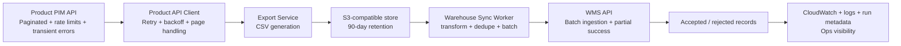

# Architecture and justification

## Overview

The solution sync product list across services in batches with handled retries, deduplication and logging.

The core design is: fetch all catalogue pages from the PIM, persist the export to a durable local/S3-compatible store, then transform and send unique product records to the WMS in batches with safe retry and partial-success handling.

## Architecture diagram

## Major components

### 1. Product API client
The PIM client is responsible for paginated reads and resilience against the documented failure modes:
- 429 rate limiting
- HTTP 5xx failures
- slow responses
- pagination gaps
- API-key authentication

It uses bounded retries with exponential backoff and respects any `Retry-After` header when the remote service sends one.

### 2. Export service
The export service requests the full catalogue, writes it to CSV, and stores the original file in a durable S3-compatible path. This preserves the exact raw export for each logical export run, which is important for operational recovery and audits.

### 3. Run state / orchestration boundary
Each run is assigned a logical identifier and a manifest with status transitions:
- running
- exported
- completed
- failed

This gives operators a reliable way to tell whether a job is active or whether a past run succeeded or failed without re-reading the entire system.

### 4. Warehouse sync worker
The warehouse worker reads the CSV export, transforms the rows into WMS-specific payloads, deduplicates by stable product key, and submits them in batches that honor the WMS batch limit. It records accepted and rejected records and keeps the result in the run manifest.

### 5. S3-equivalent storage layer
The repository uses a local filesystem implementation as a stand-in for S3. In AWS terms this would map to S3 objects storing raw export files and run metadata. This lets the code run locally while preserving the correct production design boundary.

## Execution flow

1. Start a run and create a run identifier.
2. Fetch all PIM pages until `has_next` is false.
3. Write the raw catalogue export as CSV.
4. Persist the original export in the S3-compatible store.
5. Create a run manifest with the state and export path.
6. Read the exported CSV.
7. Transform rows into WMS shape.
8. Remove duplicates by SKU using a business-safe deduplication rule.
9. Submit batches to the WMS API with retry for transient failures.
10. Record accepted and rejected product IDs and final status.

## Data flow

The flow is deliberately segmented into two durable boundaries:
- raw export data
- transformed WMS payloads

This prevents the pipeline from losing the original export when later processing fails. It also makes it possible to rehydrate from the original CSV and continue without re-pulling the entire PIM catalogue.

## Failure and retry flow

The production risk is dominated by API throttling, intermittent server errors, and partial processing. The implementation addresses that by:

- retrying only transient HTTP codes: 408, 429, 500, 502, 503, 504
- honoring `Retry-After` when provided
- using bounded exponential backoff to avoid hammering the APIs
- separating batch retries from whole-run restarts
- capturing the run manifest and failure reason so operators can investigate without rerunning the entire process unnecessarily

## Scaling approach

The design remains compatible with the expected growth from 250k to 1M products because it is page-based and batch-based rather than assuming an entire-catalogue single in-memory collection. In a production AWS deployment, the work can scale by running the export and sync stages as scheduled jobs or worker tasks without changing the business logic.

## Handling API rate limits

The implementation enforces the documented rate limits in the client layer by:
- retrying with backoff on 429 responses
- limiting request concurrency
- respecting response `Retry-After` values
- avoiding broad retry storms by capping retries

This keeps the pipeline within service limits without turning the export into a thundering herd.

## Handling partial failures

The WMS can accept some records and reject others. The code treats those outcomes as partial success, not catastrophic failure. It writes both accepted and rejected results to the run manifest and leaves the export intact for later reprocessing or investigation.

The pipeline should only retry failed or missing products, not the entire catalogue, whenever practical.

## Duplicate and ambiguous processing

The business requirement says: “The same product must never be sent twice.”

The implementation takes a conservative interpretation: a product is treated as a duplicate if it has the same stable SKU in the same run. We also persist run metadata so repeated processing can be detected and skipped without re-sending already accepted records.

If the meaning of “same product” is later refined by business rules, the dedupe key can be upgraded to a stronger immutable identifier or an idempotency ledger keyed by SKU plus warehouse destination.

## AWS service choices

These are the recommended AWS services for the real production deployment:

- S3: raw catalogue export archive and run metadata storage
- ECS or AWS Batch: scheduled catalogue sync worker
- CloudWatch Logs: operational logs and run diagnostics
- IAM: least-privilege permissions for S3 and service access
- EventBridge Scheduler: daily scheduled run
- possibly SQS or Step Functions for a more resilient orchestration layer in a future refinement

The local implementation purposely uses a filesystem-backed S3 replacement so it can run on a developer machine without AWS credentials.

## Security and IAM

The solution assumes least-privilege access:
- the consumer reads only the specific PIM and WMS endpoints needed
- the worker writes to the export bucket only under the expected prefix
- IAM roles do not allow broad wildcard S3 access
- secrets are read from environment variables or a secrets manager rather than committed into source control

## Observability

The run manifest, log output, and S3 metadata give operators visibility into:
- current run status
- export path
- accepted and rejected record counts
- failure reason
- run timestamps

This is deliberately lightweight but safe for a production workload. In AWS, the same model maps naturally to CloudWatch Logs and structured JSON logging.

## Important trade-offs

- The local S3 abstraction is deliberately simple, but it mirrors the expected production boundary. Real AWS S3 would add durability, versioning, and retention controls.
- The deduplication strategy is explicit and conservative, which avoids duplicate sends but requires a durable ledger for long-lived idempotency enforcement.
- The architecture keeps the code understandable and testable rather than trying to build an overly complex distributed orchestration system prematurely.
- The solution is intentionally focused on the highest-risk failure modes: rate limits, retries, partial success, and reprocessing safety.
